<!-- ====== ANIMATED HEADER ====== --> 
  
 <!-- ====== TYPING ANIMATION ====== --> 
  
 
    

👩‍💻 About Me
yaml
name:      Kinza Kanwal
location:  Melbourne, Australia 🇦🇺
education: Bachelor of IT (Cybersecurity) — Victorian Institute of Technology
focus:     [SOC Operations, Log Analysis, Threat Detection, IT Support]
currently:
  - 🛡️ Building hands-on SOC skills through daily labs
  - 📚 Studying for CompTIA Security+
  - 🐍 Sharpening Python for security automation
looking_for: Junior IT Support / SOC Analyst opportunities
🏢 IT Support Intern @ Zed Real Estate — built a social media lead analytics dashboard (industry project)
🤖 AI Training Data Evaluator @ Outlier
🧪 Built a home SIEM lab in VirtualBox to practise detection & log analysis
🚀 NASA Space Apps Challenge 2026 — Flame in Freefall fire-safety dashboard
🛠️ Tech Stack

  
 
        

📌 Featured Projects
Project	Description	Tech
🛡️ SOC_Analyst	Day-by-day SOC labs: log analysis, threat detection and real-world incident scenarios	SIEM · Linux · Windows Logs
🐍 PythonJourney	Daily Python notes, exercises and small projects documenting my learning path	Python
🧪 Home SIEM Lab	Virtualised lab environment for collecting and analysing security events	VirtualBox · SIEM
📊 Lead Analytics Dashboard	Industry project for Zed Real Estate — social media lead analytics	Python · Data Viz
🔥 Flame in Freefall	NASA Space Apps 2026 — fire safety dashboard from microgravity combustion data	Python · NASA Data
🏅 Certifications

     

📊 GitHub Stats

   
 
  
 
  

🐍 Contribution Snake

 <picture> <source media="(prefers-color-scheme: dark)" srcset="https://raw.githubusercontent.com/kinzawww/kinzawww/output/github-snake-dark.svg" />  </picture> 

 <i>"Security is not a product, but a process."</i> 🔐 
 <!-- ====== ANIMATED FOOTER ====== --> 
  

